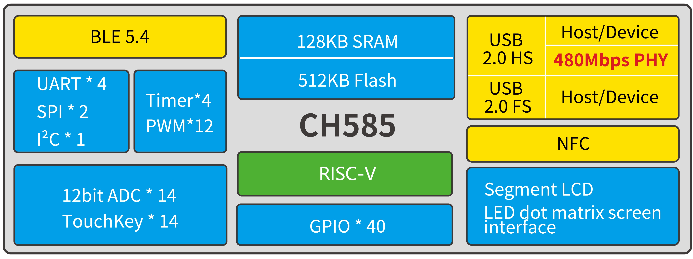
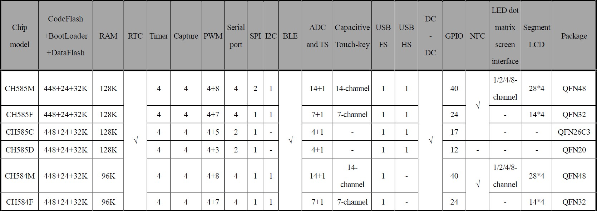

<div dir="rtl" align="right">

<p align="center"></p>

<p align="center"></p>

# کتابخانه HAL برای میکروکنترلرهای WCH CH5xx | ch5xx-hal

<p align="center"></p>

## معرفی

مخزن **ch5xx-hal** یک کتابخانه **Hardware Abstraction Layer (HAL)** برای میکروکنترلرهای بی‌سیم خانواده **WCH CH5xx** است که با زبان **Rust** توسعه داده شده است. این کتابخانه دسترسی ساخت‌یافته به واحدهای جانبی میکروکنترلر را فراهم می‌کند و علاوه بر APIهای مسدودکننده (Blocking)، برای برخی درایورها از APIهای ناهمگام (Async) و چارچوب **Embassy** نیز پشتیبانی می‌کند.

هدف پروژه ساده‌سازی توسعه Firmware و ایجاد یک لایه نرم‌افزاری مشترک برای خانواده‌ای از میکروکنترلرهای WCH است. وضعیت پشتیبانی تراشه‌ها و درایورها ممکن است در نسخه‌های مختلف تغییر کند؛ بنابراین وضعیت جاری مخزن اصلی را مرجع قرار دهید.

> **وضعیت پروژه:** این کتابخانه در حال توسعه است و APIهای آن ممکن است تغییر کنند. طبق مستندات فعلی، CH585، CH592 و CH582 روی سخت‌افزار آزمایش شده‌اند؛ این موضوع به معنی تکمیل تمام درایورها نیست.

## تصاویر مرجع CH585

<p align="center"></p>

این تصاویر برای آشنایی با CH585 و مقایسه اولیه آن با CH584 ارائه شده‌اند. برای انتخاب قطعه، بررسی پکیج، پایه‌ها و مشخصات الکتریکی، دیتاشیت رسمی همان قطعه را بررسی کنید.

## تراشه‌های پشتیبانی‌شده

| تراشه | هسته | وضعیت |
|---|---|---|
| CH585 | QingKe V3C | آزمایش‌شده روی برد |
| CH592 | QingKe V3C | آزمایش‌شده؛ USBFS Enumeration و I2C0 در انتظار تکمیل |
| CH582 | QingKe V4A | آزمایش‌شده؛ USBFS، RTC، TouchKey و Sleep در انتظار تکمیل |
| CH584 | QingKe V3C | کامپایل می‌شود؛ بدون اعتبارسنجی روی برد |
| CH583 | QingKe V4A | کامپایل می‌شود؛ بدون اعتبارسنجی روی برد |
| CH581 | QingKe V3C | کامپایل می‌شود؛ بدون اعتبارسنجی روی برد |
| CH595 | QingKe V3C | کامپایل می‌شود؛ بدون اعتبارسنجی روی برد |
| CH573 | QingKe V3A | کامپایل می‌شود؛ بدون اعتبارسنجی روی برد |
| CH572 | QingKe V3A | کامپایل می‌شود؛ بدون اعتبارسنجی روی برد |
| CH570 | QingKe V3A | کامپایل می‌شود؛ بدون اعتبارسنجی روی برد |

تراشه‌های **CH571، CH584X و CH591** در حال حاضر قابل انتخاب نیستند. **CH564، CH565 و CH569** نیز خارج از محدوده این HAL هستند.

## وضعیت درایورها و واحدهای جانبی

| درایور / قابلیت | وضعیت فعلی |
|---|---|
| `gpio` | ورودی، خروجی، Flex Pin، Pull و انتظار برای وقفه‌های پورت |
| `rcc` | HSI/HSE، تقسیم‌کننده‌های کلاک و پیکربندی PLL |
| `uart` | UART0 تا UART3، Blocking و Async، تغییر نگاشت پایه‌ها و `embedded-io` |
| `i2c` | I2C0 Master، Blocking و Async، تا سرعت 400kHz |
| `spi` | SPI0/SPI1 Master، Blocking و Async و DMA محلی SPI0 |
| `adc` | تبدیل تکی، سنجش دما و باتری، اسکن DMA و Auto-DMA زمان‌بندی‌شده |
| `touchkey` | کلیدهای لمسی Charge-Transfer به‌صورت Polled |
| `pwm` | PWM4 تا PWM11؛ در CH572/CH570، PWM1 تا PWM5 |
| `rtc` | تقویم، Alarm یک‌باره و Interval Timer |
| `watchdog` | Window Watchdog، علت Reset و تشخیص باتری |
| `delay` | مبتنی بر SysTick یا Timebase چارچوب Embassy |
| `power` | حالت‌های Halt و Sleep با بیدارباش RTC |
| `usb` | USBFS Device، اندپوینت‌های EP0 تا EP7؛ در CH582/CH583، EP0 تا EP3 |
| `usbhs` | USBHS Device، اندپوینت‌های EP0 تا EP7 و بسته‌های Bulk با اندازه 8 تا 512 بایت |
| Embassy Time Driver | مبتنی بر SysTick یا TMR0 تا TMR3 |
| Timer Count / PWM / Capture / DMA | آزمایشی |
| USB Host / BLE / NFC | هنوز پیاده‌سازی نشده |

## شروع سریع

نمونه حداقلی برای راه‌اندازی HAL:

```rust
let p = ch5xx_hal::init(ch5xx_hal::rcc::Config::default().into());
```

پیکربندی نهایی کلاک را هنگام فراخوانی `init` انجام دهید؛ تغییر کلاک در زمان اجرا باعث بازپیکربندی خودکار درایورهای وابسته به کلاک نمی‌شود.

## تنظیمات و پیش‌نیازها

- دقیقاً یک Feature مربوط به تراشه را فعال کنید؛ برای مثال `ch585` یا `ch592`.
- برای تراشه‌های QingKe V3C از Target زیر استفاده کنید: `riscv32imc-unknown-none-elf`.
- برای هسته‌های V3A/V4A از Target زیر استفاده کنید: `riscv32imac-unknown-none-elf`.
- هسته V3C افزونه A مجموعه دستورالعمل RISC-V را به‌شکل قابل استفاده پشتیبانی نمی‌کند.
- برای Atomicهای اشتراکی از `portable-atomic` همراه Feature با نام `critical-section` استفاده کنید.
- Feature مربوط به `+b` را بدون بررسی فعال نکنید؛ CH585 آن را اجرا می‌کند، اما CH592 در مواجهه با آن Trap می‌دهد.
- در صورت فعال‌سازی `embassy`، دقیقاً یکی از Featureهای `time-driver-systick` یا `time-driver-tmr0` تا `time-driver-tmr3` را انتخاب کنید.
- در Crateهای اجرایی (Binary)، Feature با نام `memory-x` را فعال کنید.

## اجرای مثال‌ها

برای اجرای مثال‌های CH585:

```console
cd examples/ch585
cargo run --release --bin blinky
```

فرمان `cargo run` از `probe-rs run --chip CH585` برای پروگرام، Reset و دریافت خروجی `defmt` از طریق RTT استفاده می‌کند. برای سیم‌بندی و جزئیات مثال‌ها به README پوشه مربوطه مراجعه کنید:

- [مثال‌های CH585](examples/ch585/)
- [مثال‌های CH592](examples/ch592/)
- [مثال‌های CH572](examples/ch572/)

### انتخاب Time Driver در مثال‌های CH585

مثال‌ها به‌صورت پیش‌فرض از `time-driver-systick` استفاده می‌کنند. برای انتخاب TMR بدون ویرایش Manifest:

```console
cargo run --release --bin embassy_time_tmr --no-default-features --features time-driver-tmr0
```

مثال `embassy_time_tmr` عمداً SysTick را رد می‌کند. برای ساخت همه Binaryها با TMR:

```console
cargo build --release --bins --no-default-features --features time-driver-tmr0
```

## ساختار مخزن

| مسیر | توضیحات |
|---|---|
| [examples/ch585](examples/ch585/) | مثال‌های `no_std` برای CH585 مبتنی بر QingKe V3C |
| [examples/ch592](examples/ch592/) | مثال‌های CH592 |
| [examples/ch572](examples/ch572/) | مثال‌های CH572 |
| [image](image/) | تصاویر مرجع CH585 و راهنمای انتخاب CH585/CH584 |

## منابع مرتبط

- [مخزن ch5xx-hal](https://github.com/MEMAR-ELECTRONIC-SANAT/ch5xx-hal)
- [مستندات سخت‌افزاری و منابع CH585 در MES](https://github.com/MEMAR-ELECTRONIC-SANAT/MES-CH585)
- [داده‌ها و متادیتای رجیسترهای CH5xx](https://github.com/ch32-rs/ch5xx-data)
- [مستندات API در docs.rs](https://docs.rs/ch5xx-hal)

## مجوز و ملاحظات استفاده

پروژه اصلی **ch5xx-hal** تحت یکی از دو مجوز **Apache License, Version 2.0** یا **MIT License**، به انتخاب استفاده‌کننده، منتشر شده است. پیش از استفاده، بازتوزیع یا تغییر کد، فایل‌های مجوز و شرایط انتشار را در مخزن اصلی بررسی کنید.

---

## تصاویر و دیاگرام‌های راهنما

پوشه [image](image/) شامل تصاویر مرجع CH585 و راهنمای مقایسه CH585/CH584 است. فایل‌های هویت بصری MES نیز در [Images/GitHub-Assets](Images/GitHub-Assets/) قرار دارند.

<p align="center"></p>

| فایل | کاربرد |
|---|---|
| [MES-Hero-Banner.svg](Images/GitHub-Assets/MES-Hero-Banner.svg) | سربرگ اصلی README |
| [MES-Divider.svg](Images/GitHub-Assets/MES-Divider.svg) | جداکننده بخش‌ها |
| [MES-Section-Header.svg](Images/GitHub-Assets/MES-Section-Header.svg) | عنوان بصری بخش‌ها |
| [MES-Project-Card.svg](Images/GitHub-Assets/MES-Project-Card.svg) | معرفی پروژه |
| [MES-Status-Strip.svg](Images/GitHub-Assets/MES-Status-Strip.svg) | نمایش وضعیت و منابع |
| [MES-Thank-You-Footer.svg](Images/GitHub-Assets/MES-Thank-You-Footer.svg) | تصویر پایانی README |

<p align="center"></p>

## تهیه و تدوین

**معمار الکترونیک صنعت**  
**MEMAR ELECTRONIC SANAT (MES)**

همراه شما در مسیر طراحی و ساخت مدارهای مطمئن

- تلگرام: [https://t.me/Memar_Electronic](https://t.me/Memar_Electronic)
- اینستاگرام: [https://www.instagram.com/Memar.Electronic](https://www.instagram.com/Memar.Electronic)

[مشاهده سایر آموزش‌ها](https://github.com/MEMAR-ELECTRONIC-SANAT)

</div>

---

# ch5xx-hal | Rust HAL for WCH CH5xx Microcontrollers

<p align="center"></p>

## Overview

**ch5xx-hal** is a **Hardware Abstraction Layer (HAL)** for WCH **CH5xx wireless microcontrollers**, written in **Rust**. It provides structured APIs for on-chip peripherals, with blocking interfaces and asynchronous APIs plus **Embassy** support for selected drivers.

The project aims to simplify firmware development and provide a shared software abstraction across supported WCH microcontrollers. Device and driver support may change between revisions; consult the repository's current status tables and documentation.

> **Project status:** The HAL is under development and its APIs may change. According to the current project documentation, CH585, CH592 and CH582 have been exercised on hardware. This does not mean every driver is complete.

## CH585 Reference Images

<p align="center"></p>

These images provide a visual reference to the CH585 and an initial comparison with the CH584. Always consult the relevant datasheet for package selection, pin availability and electrical specifications.

## Supported Devices

| Chip | Core | Status |
|---|---|---|
| CH585 | QingKe V3C | Board-tested |
| CH592 | QingKe V3C | Board-tested; USBFS enumeration and I2C0 pending |
| CH582 | QingKe V4A | Board-tested; USBFS, RTC, TouchKey and sleep pending |
| CH584 | QingKe V3C | Builds; no board validation |
| CH583 | QingKe V4A | Builds; no board validation |
| CH581 | QingKe V3C | Builds; no board validation |
| CH595 | QingKe V3C | Builds; no board validation |
| CH573 | QingKe V3A | Builds; no board validation |
| CH572 | QingKe V3A | Builds; no board validation |
| CH570 | QingKe V3A | Builds; no board validation |

CH571, CH584X and CH591 are not selectable yet. CH564, CH565 and CH569 are outside the scope of this HAL.

## Driver Status

| Driver / Feature | Current status |
|---|---|
| `gpio` | Input, output, flex pins, pulls and port-interrupt waits |
| `rcc` | HSI/HSE, dividers and PLL configuration |
| `uart` | UART0–UART3, blocking and async, remapping and `embedded-io` |
| `i2c` | I2C0 master, blocking and async, up to 400kHz |
| `spi` | SPI0/SPI1 master, blocking and async, SPI0 local DMA |
| `adc` | Single conversion, temperature, battery, DMA scan and timed auto-DMA |
| `touchkey` | Polled charge-transfer touch keys |
| `pwm` | PWM4–PWM11; PWM1–PWM5 on CH572/CH570 |
| `rtc` | Calendar, one-shot alarm and interval timer |
| `watchdog` | Window watchdog, reset cause and battery detector |
| `delay` | SysTick or the Embassy timebase |
| `power` | Halt and sleep, with RTC wake-up |
| `usb` | USBFS device, EP0–7 (EP0–3 on CH582/CH583) |
| `usbhs` | USBHS device, EP0–7, 8–512-byte bulk packets |
| Embassy time driver | SysTick or TMR0–TMR3 |
| Timer count / PWM / capture / DMA | Experimental |
| USB Host / BLE / NFC | Not implemented |

## Quick Start

A minimal HAL initialization example:

```rust
let p = ch5xx_hal::init(ch5xx_hal::rcc::Config::default().into());
```

Configure the final clock during initialization. Runtime clock changes do not automatically rebuild clock-dependent drivers.

## Required Configuration

- Enable exactly one chip feature, for example `ch585` or `ch592`.
- Use `riscv32imc-unknown-none-elf` for QingKe V3C devices.
- Use `riscv32imac-unknown-none-elf` for V3A/V4A cores.
- The V3C core has no usable RISC-V A extension.
- Use `portable-atomic` with its `critical-section` feature for shared atomics.
- Do not enable `+b` blindly: CH585 executes it, while CH592 traps on it.
- With `embassy`, enable exactly one of `time-driver-systick` or `time-driver-tmr0` through `time-driver-tmr3`.
- Enable `memory-x` in binary crates.

## Running Examples

To run the CH585 examples:

```console
cd examples/ch585
cargo run --release --bin blinky
```

The `cargo run` command uses `probe-rs run --chip CH585` to flash and reset the target and stream `defmt` output over RTT. For wiring and binary details, see:

- [CH585 examples](examples/ch585/)
- [CH592 examples](examples/ch592/)
- [CH572 examples](examples/ch572/)

### Selecting the Time Driver

The examples default to `time-driver-systick`. To select a TMR driver without editing the manifest:

```console
cargo run --release --bin embassy_time_tmr --no-default-features --features time-driver-tmr0
```

The `embassy_time_tmr` example intentionally rejects SysTick. To build all binaries with a TMR driver:

```console
cargo build --release --bins --no-default-features --features time-driver-tmr0
```

## Repository Structure

| Path | Description |
|---|---|
| [examples/ch585](examples/ch585/) | `no_std` examples for CH585 based on QingKe V3C |
| [examples/ch592](examples/ch592/) | CH592 examples |
| [examples/ch572](examples/ch572/) | CH572 examples |
| [image](image/) | CH585 reference images and CH585/CH584 product selection guide |

## Related Resources

- [ch5xx-hal repository](https://github.com/MEMAR-ELECTRONIC-SANAT/ch5xx-hal)
- [MES CH585 hardware documentation and resources](https://github.com/MEMAR-ELECTRONIC-SANAT/MES-CH585)
- [CH5xx register data and metadata](https://github.com/ch32-rs/ch5xx-data)
- [API documentation on docs.rs](https://docs.rs/ch5xx-hal)

## License and Usage Notes

The upstream **ch5xx-hal** project is licensed under either the **Apache License, Version 2.0** or the **MIT License**, at your option. Before using, redistributing or modifying the code, review the license files and terms in the upstream repository.

---

## Images and Reference Diagrams

The [image](image/) directory contains CH585 reference images and the CH585/CH584 selection guide. MES visual identity assets are available in [Images/GitHub-Assets](Images/GitHub-Assets/).

<p align="center"></p>

| File | Purpose |
|---|---|
| [MES-Hero-Banner.svg](Images/GitHub-Assets/MES-Hero-Banner.svg) | Main README banner |
| [MES-Divider.svg](Images/GitHub-Assets/MES-Divider.svg) | Section divider |
| [MES-Section-Header.svg](Images/GitHub-Assets/MES-Section-Header.svg) | Visual section heading |
| [MES-Project-Card.svg](Images/GitHub-Assets/MES-Project-Card.svg) | Project showcase |
| [MES-Status-Strip.svg](Images/GitHub-Assets/MES-Status-Strip.svg) | Status and resource strip |
| [MES-Thank-You-Footer.svg](Images/GitHub-Assets/MES-Thank-You-Footer.svg) | README footer artwork |

<p align="center"></p>

## Credits and Documentation

**MEMAR ELECTRONIC SANAT (MES)**

*Your partner in designing and building reliable circuits.*

- Telegram: [https://t.me/Memar_Electronic](https://t.me/Memar_Electronic)
- Instagram: [https://www.instagram.com/Memar.Electronic](https://www.instagram.com/Memar.Electronic)

[Explore more tutorials](https://github.com/MEMAR-ELECTRONIC-SANAT)
